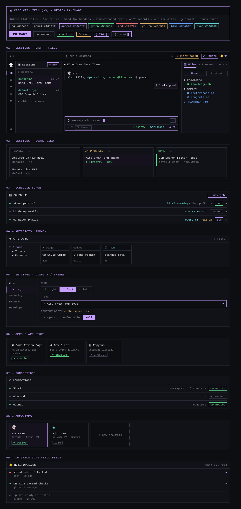

# Kiro Crew Term (v3) 👻

A Kiro Crew dashboard theme that mirrors the look of **kiro-cli v3** (the
refreshed `--tui` terminal experience): a near-black terminal canvas, the Kiro
violet accent (`#c6a0ff`), ANSI-styled status and diff colors, and a
mono-forward type system.

- **Level:** 1 (colors + fonts + scoped structural CSS)
- **Fonts:** [Inter](https://github.com/rsms/inter) (sans) and
  [JetBrains Mono](https://github.com/JetBrains/JetBrainsMono) (mono + code),
  both SIL Open Font License 1.1.
- **Palettes:** `dark` (the v3 dark terminal) and `light` (the v3 light/safe
  variant).

## Design direction

The image below is the **target aesthetic** for the theme across the main
dashboard screens — flat fills, 0px radius, hard 1px borders, ANSI accents, a
`❯` prompt and block caret.

> **What this pack delivers today vs. the target.** This is a Kiro Crew *theme
> pack*, so it can only change the **palette and fonts**, plus limited
> structural CSS on a small set of runtime-allowlisted surfaces. The dashboard's
> components (session cards, file tree, tab strips, status pills, the icon rail)
> use framework-generated class names a theme pack cannot target, so their
> **shape, radius, and layout stay as the dashboard draws them — only recolored
> and re-fonted.** The flat/sharp terminal *structure* shown above is the
> design goal; reaching it fully would require native shape/layout theming
> support in the dashboard that does not exist yet. Install this for the v3
> **color + type** experience; treat the mockup as the roadmap.

## Install

Settings → Display → Install theme, then paste either:

- this repo URL (`https://github.com/revagomes/kirocrew-term`), or
- the local folder path if you have it checked out.

Re-installing overwrites the previous copy — that is the update path.

## What it themes

- Palette of 37 variables per polarity (only the three required vars are
  mandatory; the rest are tuned so surfaces, borders, JSON syntax, and terminal
  hues read like the v3 TUI). Diff colors are left to the dashboard to
  auto-derive from each polarity.
- Sans face → Sans option; Mono face → Mono option **and** all code surfaces.
- `styles/overrides.css` applies the flat/sharp language on the runtime's
  allowlisted surfaces: 0px radius and hard borders on `.sidebar`,
  `.chat-container`, `.message-bubble`, `.code-block`, `.input-area` and
  `button.primary`, an accent underline on `.topbar`, a left accent caret-rail
  on the input, and a faint terminal grain on `body`. These are the only
  surfaces a theme pack can reach — see the companion userstyle below for the
  rest of the dashboard.

## Flat/sharp shape — companion userstyle (optional)

The theme pack recolors the dashboard but **cannot change component shape**
(radius, borders, layout): the dashboard is built on framework-generated utility
classes a theme pack is not allowed to target. To get the full flat/sharp
terminal *structure* shown in the preview, install the companion **userstyle**:

1. Install a userstyle manager — [Stylus](https://add0n.com/stylus.html)
   (Chrome/Firefox) is recommended.
2. Open `userstyle/kirocrew-term.user.css` from this repo and install it
   (Stylus detects the `==UserStyle==` header), **or** paste its contents into a
   new Stylus style scoped to your dashboard origin.
3. Adjust the `url-prefix(...)` lines at the top if your dashboard runs on a
   host/port other than `localhost:5476`.

How it works: the dashboard's rounded corners resolve through its own
`--radius-*` CSS variables, so the userstyle zeroes those (`--radius-lg: 0`,
etc.) and squares every surface in one move — verified against the live DOM.
It changes **shape only**; the palette and fonts still come from the theme pack,
so the two layers compose.

> This is a per-browser install, not part of the shareable theme pack — that
> separation is the whole point: colour for everyone via the pack, shape for
> whoever wants it via the userstyle.

### Desktop app (Electron)

The desktop app has no custom-CSS setting and can't load a Stylus userstyle, so
use its **DevTools** instead (DevTools must be enabled):

1. Open DevTools in the desktop app.
2. Paste the contents of `userstyle/console-inject.js` into the **Console** and
   press Enter — the app goes flat/sharp immediately.
3. Not persistent across restarts. To avoid re-pasting, save it once as a
   **DevTools Snippet** (Sources → Snippets) and run it after each launch.

The snippet injects the same radius-zeroing CSS as the userstyle. For a
fully set-and-forget experience, run the dashboard in a browser with Stylus —
the desktop app has no supported auto-load hook, and patching its bundled
assets is unsupported and breaks on update.

## Notes

- The System font option always stays the OS font; a theme pack cannot change
  it, by design.
- Fonts are declared only through the role system in `theme.json`; none are set
  in CSS (the runtime rejects that).

## License

Theme sources: MIT. Bundled fonts: SIL OFL 1.1. See `LICENSE.txt`.
